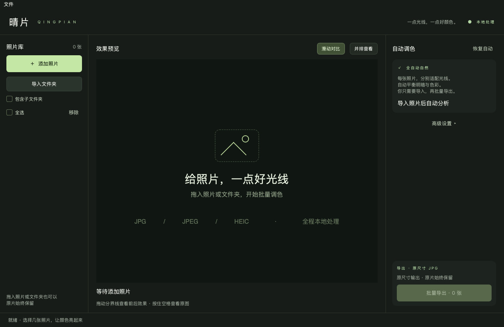

# 晴片 Qingpian

**导入照片 → 逐张自动调光调色 → 批量导出。**

晴片是一个使用 Python、Qt 编写的本地桌面工具，面向手机原相机拍摄的 JPG、JPEG、HEIC / HEIF 照片。它会根据每张照片的亮度分布、中央区域明暗和色彩状态，分别决定处理力度，默认无需手动调节参数。

适合希望快速改善偏暗生活照、人像和整批手机照片的用户。处理目标是自然、克制地改善明暗与色彩；极端光线和有意创作的色调仍建议抽样查看效果。



> 截图为无照片的初始界面，不包含个人照片。

## Mac 版下载（无需安装 Python）

**[下载晴片 v0.1.0 · Apple Silicon Mac](https://github.com/xxxxx-feng/qingpian/releases/download/v0.1.0/Qingpian-0.1.0-macOS-arm64.zip)**

适用于 **M 系列芯片、macOS 14+**。解压后得到 `晴片.app`，放到桌面或“应用程序”中双击即可使用。也可在 [Release 页面](https://github.com/xxxxx-feng/qingpian/releases/tag/v0.1.0) 查看说明和 SHA-256 校验文件。

此包未经过 Apple Developer ID 签名与 Apple 公证，其他 Mac 首次打开可能遇到系统来源验证提示。请确认下载来源后参考 [Apple 官方说明](https://support.apple.com/en-us/102445)。源码运行、Intel Mac 和自行构建说明见下文。

## 目录

- [主要功能](#主要功能)
- [运行环境](#运行环境)
- [快速开始](#快速开始)
- [日常使用](#日常使用)
- [全自动模式如何工作](#全自动模式如何工作)
- [高级设置](#高级设置)
- [原片与隐私](#原片与隐私)
- [支持的格式与导出规则](#支持的格式与导出规则)
- [已知局限](#已知局限)
- [项目结构](#项目结构)
- [开发与测试](#开发与测试)
- [构建 Mac 应用](#构建-mac-应用)
- [常见问题](#常见问题)
- [许可证与参考资料](#许可证与参考资料)

## 主要功能

| 功能 | 说明 |
| --- | --- |
| 全自动自然 | 每张照片独立计算曝光、暗部、高光、对比度、色彩及小幅白平衡修正 |
| 批量导入 | 添加多张照片、导入文件夹或拖入文件 / 文件夹；可包含子文件夹 |
| 无需逐张预览 | 导入后默认全选，直接批量导出；没有预览过的照片也会正常处理 |
| 前后对比 | 滑动分界线或并排查看；按住空格临时查看原图 |
| 高级预设 | 保留影楼自然光、自然提亮、清透日常、温暖人像及手动滑块 |
| 手机照片适配 | 读取 JPG / JPEG / HEIC / HEIF，处理 EXIF 方向和受支持的色彩配置 |
| 原尺寸输出 | 预览缩小加速，最终重新读取原片并按完整像素尺寸导出 |
| 保留原片 | 另存 JPG；同名自动编号，重复导出也不覆盖已有文件 |
| 批处理容错 | 单张坏文件不会中断整批；支持取消并保留已完成结果 |
| 本地处理 | 图像处理不调用云端服务，没有照片上传接口或遥测 |

## 运行环境

- **Python 3.10 或更新版本**，建议使用 Python 3.12。
- 使用 Pillow、NumPy、pillow-heif、PySide6 Essentials，完整版本范围见 [requirements.txt](requirements.txt)。
- 已在 **Apple Silicon Mac、macOS 26.6.2、Python 3.12** 实际验证。
- 本次 Mac 打包所用的 Qt / NumPy 轮子面向 macOS 14+；其他版本请以实际依赖兼容性为准。
- 源码采用跨平台 Qt 接口；Windows / Linux 的日常桌面使用尚未经过同等实机验证。
- HEIC 解码依赖 pillow-heif / libheif。使用对应平台的官方预编译轮子时通常无需另外安装 Qt 或 libheif。

实际验证版本记录在 [requirements-tested.txt](requirements-tested.txt)。该文件也包含构建工具，主要用于重现当前 Mac 环境，不是跨平台通用的依赖锁文件。

## 快速开始

### macOS：从源码启动

```bash
git clone https://github.com/xxxxx-feng/qingpian.git
cd qingpian

python3.12 -m venv .venv
.venv/bin/python -m pip install -r requirements.txt
.venv/bin/python app.py
```

如果没有 `python3.12`，可以使用本机满足版本要求的 `python3`。

也可以在 Finder 中双击 **`启动晴片.command`**：

- 如果项目中已有 `dist/晴片.app`，启动器优先打开打包应用。
- 否则查找 Python 3.10+，在项目内创建 `.venv`，首次安装依赖后打开窗口。
- 首次安装依赖需要网络，之后的照片处理始终在本机完成。
- 如双击启动器提示没有执行权限，可先在项目目录运行 `chmod +x 启动晴片.command`。

### Windows：从源码运行

在 PowerShell 中进入项目目录后：

```powershell
py -3.12 -m venv .venv
.\.venv\Scripts\python.exe -m pip install -r requirements.txt
.\.venv\Scripts\python.exe app.py
```

此路径基于通用 Python / Qt 启动方式提供，Windows 桌面行为仍需实机验证。

### 启动时导入指定照片

```bash
.venv/bin/python app.py "/path/to/photo.jpg" "/path/to/photos"
```

支持同时传入文件和文件夹。文件夹是否递归扫描由界面中的“包含子文件夹”选项控制，默认为关闭。

## 日常使用

1. **导入**：点击“添加照片”“导入文件夹”，或把照片拖进窗口。支持的照片会自动去重并默认全选。
2. **导出**：保持“全自动自然”，点击“批量导出”并选择保存位置。

工具会在选择的位置新建 **`晴片导出`** 文件夹。完成后可以点击“打开导出文件夹”。

预览是可选步骤。点击左侧某张照片即可查看处理结果，右侧会显示“柔和提亮”“逆光提亮 · 高光保护”等摘要。默认界面收起手动参数，普通使用无需展开“高级设置”。

如果只想导出部分照片，可取消勾选其他照片。列表中的当前预览项与导出勾选项相互独立。

### 常用操作

| 操作 | 作用 |
| --- | --- |
| 添加照片 / `⌘O` | 导入多张照片 |
| 批量导出 / `⌘S` | 处理所有勾选照片 |
| 拖动预览分界线 | 查看原图与调整后的差异 |
| 按住空格 | 临时查看原图，松开返回 |
| 移除 / Backspace | 从列表移除当前照片，不删除磁盘原片 |
| 恢复自动 | 回到全自动模式 |
| 取消导出 | 在安全检查点停止，保留已完成文件 |

## 全自动模式如何工作

全自动模式不会给整批照片套用相同曝光或固定调色数值。每张照片都经过以下流程：

1. **规范输入**：解码图像，按 EXIF 方向旋转像素，转换受支持的色彩空间到 sRGB。
2. **分析原片**：在缩小预览之前，从原片提取亮度分布、中央区域明暗、饱和程度及近中性色分布。
3. **计算方案**：为该照片生成独立的 `AutoPlan`。
4. **分块处理**：应用曝光、暗部、高光、对比度、白平衡和色彩调整，并压缩超出显示色域的颜色。
5. **原尺寸导出**：重新读取原片并使用相同分析规则处理，保存完整尺寸 JPG。

### 自动调整策略

| 项目 | 策略 |
| --- | --- |
| 曝光 | 综合全图与中央区域测光；偏暗适度提亮，已明亮的照片不会继续追加曝光 |
| 逆光类场景 | 检测亮背景、暗中央区域的分布，增加中央测光权重和暗部补偿 |
| 暗光 | 限制曝光和暗部提升力度，尽量保留暗光氛围并减少噪点被放大 |
| 高光 | 根据明亮区域比例调整保护力度；无法恢复原片已经丢失的信息 |
| 对比度 | 根据亮度范围做小幅调整，避免一律使用强对比 |
| 自然鲜艳 | 根据原片饱和程度增减；对暖色区域减少额外增色 |
| 偏色 | 仅在多个区域、不同亮度的近中性色相互一致时，小幅修正白平衡；证据不足时保留原色温 |

`AutoPlan` 在预览缩小之前计算，因此同一原片的预览与完整导出不会因预览尺寸不同而采用不同的自动参数。缩放与 JPEG 编码本身仍会带来细小视觉差异。

这些策略是**本地、确定性的图像分析规则**，不依赖云端 AI，也不包含人脸识别。界面中的“逆光”“暗光”是启发式判断，不等同于对拍摄场景或意图的准确识别。

## 高级设置

展开“高级设置”后可以选择手动预设、微调参数，以及修改 JPG 品质和 EXIF 保留选项。全自动模式下滑块禁用；选择其他预设后可以手动调整。

| 预设 | 风格 |
| --- | --- |
| 全自动自然 | 默认模式：逐张适配明暗与色彩，无需调参数 |
| 影楼自然光 | 柔和提亮、较克制的色彩，沿用原片色温 |
| 自然提亮 | 通用提亮，颜色增强略高 |
| 清透日常 | 较鲜明、略偏冷的日常风格 |
| 温暖人像 | 暖色、较柔和的对比 |

“影楼自然光”是本项目设计的自然风格起点，不是某家照相馆的配方或通用专业标准。

手动滑块包括智能提亮、曝光补偿、暗部细节、高光保护、对比度、色温、自然鲜艳和整体强度。手动模式仍会逐张分析基础亮度，其余滑块对整批采用相同设置。

**滑块数值属于晴片自己的算法刻度，不能直接对应 Lightroom、Photoshop 或其他软件中的同名参数。**

## 原片与隐私

- 原片以只读方式打开，不覆盖、不移动、不修改。
- 处理结果保存在新文件中；同名时自动增加编号，避免覆盖旧导出。
- 图像处理不联网，不上传照片，没有账号、云端服务或遥测。
- 默认保留常见拍摄信息，包括相机型号、拍摄日期、曝光参数及原有 GPS 定位。
- 展开高级设置后，取消“保留拍摄信息”可移除 EXIF，包括定位；仍保留显示颜色所需的 sRGB 配置。
- 不复制格式专属 Maker Notes、旧缩略图或无法可靠迁移的元数据。
- 源码与测试仅使用程序生成的临时图片；仓库不包含个人照片或本机凭据。

## 支持的格式与导出规则

| 项目 | 支持情况 |
| --- | --- |
| 输入 | `.jpg`、`.jpeg`、`.heic`、`.heif`，扩展名大小写均可 |
| 输出 | 普通 8 位 SDR JPG，嵌入 sRGB ICC 配置 |
| 尺寸 | 保留原始像素尺寸；按 EXIF 旋转后宽高可能互换 |
| 品质 | 默认 95%，可选 100% 或 85%；JPG 始终是有损格式 |
| 文件名 | `原文件名_晴片.jpg`，重复时使用 `_晴片_2.jpg` 等编号 |
| 拍摄方向 | 转为实际像素方向，导出后不依赖方向标签 |
| 色彩 | 支持 ICC → sRGB，以及使用 sRGB 传递曲线的 Display P3 NCLX HEIC |
| HDR / 动态照片 | 不保留 HDR 增益图、Live Photo 视频、景深或其他辅助图像 |

检测到暂时无法可靠转换的 PQ / HLG 或其他色彩空间时，会提示先从相册导出为 SDR JPG。

## 已知局限

- **审美没有统一答案**：自动模式以自然、克制为目标，不能保证每张照片都符合个人喜好。
- **场景判断并非语义识别**：中央测光与直方图可能把“人物暗、桌面亮”归为逆光类场景。
- **亮部仍有优化空间**：亮暗对比强的室内照片中，白色餐具、纸巾或反光区域可能仍偏亮。
- **无法找回已丢失的信息**：原片纯白过曝、纯黑、模糊或强压缩损失不能靠调色恢复。
- **不包含 AI 降噪或精修**：提亮可能放大噪点；没有磨皮、换脸、背景替换等功能。
- **复杂光线**：舞台灯、混合光、纯色主体、有意保留的夕阳色调可能不适合自动校正。
- **高分辨率处理需要内存**：分块计算降低浮点缓存开销，但仍需完整解码与保存像素图像。
- **取消有检查点**：单张 HEIC 解码或 JPG 编码期间可能需稍等；已完成的结果会保留。

对重要照片，建议先抽样查看几张典型场景，再进行整批导出。

## 项目结构

```text
qingpian/
├── app.py                     # 启动入口，支持照片 / 文件夹参数
├── photo_tool/
│   ├── __init__.py
│   ├── gui.py                 # Qt 界面、后台任务、预览与导出交互
│   └── processing.py          # 解码、色彩转换、自动分析、调色与安全导出
├── tests/
│   ├── test_automatic.py      # 自动方案与典型明暗 / 色彩场景
│   ├── test_processing.py     # HEIC、EXIF、旋转、取消与文件安全
│   └── test_gui.py            # 离屏界面与批处理端到端检查
├── docs/images/app.png        # 不含个人照片的界面截图
├── requirements.txt           # 运行依赖版本范围
├── requirements-tested.txt    # 当前 Mac 验证环境
├── build_mac.py               # 构建自带依赖的 .app
└── 启动晴片.command           # Mac 双击启动器
```

### 核心接口

```python
from pathlib import Path
from photo_tool.processing import Adjustments, export_batch

successes, failures = export_batch(
    paths=[Path("input/a.jpg"), Path("input/b.heic")],
    output_dir=Path("output"),
    settings=Adjustments(adaptive=True),
    quality=95,
    keep_metadata=False,
)

print("成功：", len(successes), "失败：", len(failures))
```

`Adjustments(adaptive=True)` 启用逐张全自动处理。接口还支持取消事件及进度回调，具体定义见 `photo_tool/processing.py`。

## 开发与测试

```bash
.venv/bin/python -m unittest discover -s tests -v
```

当前 **32 项自动化检查已在 Mac 验证环境通过**，覆盖：

- 暗图与亮图采用不同曝光和色调力度。
- 逆光类场景中的暗部主体与亮背景处理。
- 暗光氛围、黑白稳定性、单一色调保护。
- 小幅偏色修正、置信度不足时保留色温。
- 预览与完整导出的自动分析一致性。
- 无需调整参数的界面导入 → 批量导出流程。
- JPG / HEIC 编解码、EXIF 方向、拍摄日期与 GPS 去留。
- 同名文件、防覆盖、取消与坏文件容错。

测试使用临时生成的图像，不依赖个人照片。界面测试通过 `QT_QPA_PLATFORM=offscreen` 离屏运行。

如需生成界面检查截图：

```bash
QINGPIAN_SCREENSHOTS=/tmp/qingpian-screenshots \
  .venv/bin/python -m unittest discover -s tests -p test_gui.py -v
```

打包版另已在 Mac 实际验证：导入暗光 JPG、逆光 HEIC、明亮 JPG 三张测试图，不展开高级设置、不修改参数，直接批量导出成功 3 张、失败 0 张。

## 构建 Mac 应用

在 Mac 的虚拟环境中安装运行依赖后：

```bash
.venv/bin/python -m pip install 'pyinstaller>=6.16,<7'
.venv/bin/python build_mac.py
```

输出位置：

```text
dist/晴片.app
dist/Qingpian-0.1.0-macOS-arm64.zip
dist/Qingpian-0.1.0-SHA256SUMS.txt
```

构建出的应用自带 Python、Qt 与图像处理依赖，可以复制到桌面后双击使用，无需在目标机器上另装 Python。构建架构随当前 Python 与构建机器而定；Apple Silicon 构建不代表已生成 Intel 通用版本。

`VERSION` 记录发布版本。构建脚本写入应用版本、最低系统版本、构建依赖和源码提交，重新生成 ad-hoc 签名并检查完整性，最后输出 ZIP 与校验文件。Intel 构建的 ZIP 名称会使用 `x86_64`。

`build/`、`dist/`、虚拟环境、生成的 `.spec` 和 `.local-archive/` 本地归档不提交到源码仓库。依赖许可文本在 `THIRD_PARTY_LICENSES.txt` 中，并随应用保留。升级构建依赖后，先在相同虚拟环境运行 `python generate_notices.py` 更新该文件；此收集步骤会从 GNU 官方 HTTPS 地址取得许可文本，通常的应用构建使用仓库中已收录的文本即可。

## 常见问题

### 照片需要上传吗？

不需要。只有首次安装依赖、下载源码或构建工具时需要网络，照片处理在本机完成。

### 必须逐张预览、点击“应用”吗？

不需要。导入后默认全选，直接批量导出即可。预览仅用于查看当前照片的自动效果。

### 为什么不同照片的调整程度不同？

这是全自动模式的预期行为：每张照片独立分析。明亮照片可能只轻微调整，暗照片会适度提亮。

### HEIC 为什么导出成 JPG？

当前版本统一导出兼容性较好的普通 JPG，便于查看和分享；不会保留 HEIC 的 HDR、动态视频或景深辅助数据。

### 导出 100% 品质就是无损吗？

不是。100% 是 JPEG 编码器的品质设置，仍会进行有损编码。原片会独立保留。

### 导出中有一张失败怎么办？

其他照片会继续处理，完成后可点击“失败详情”查看对应文件和错误原因。原片损坏、不支持的色彩配置或目录不可写都可能导致单张失败。

### 如何让效果轻一些？

默认全自动不需要设置参数。若有明确风格偏好，可展开高级设置，选择手动预设并降低“整体强度”；点击“恢复自动”可回到自动流程。

### 双击启动器没有反应怎么办？

先在终端按“快速开始”运行，查看 Python 版本和依赖安装错误。启动器会优先打开已有 `dist/晴片.app`；如要运行最新源码，直接执行 `.venv/bin/python app.py`。

## 许可证与参考资料

本仓库暂未添加项目级许可证文件。第三方依赖遵循其各自的许可，公开源代码不会替代这些组件的许可证要求。

- [Qt for Python](https://doc.qt.io/qtforpython-6/)：Qt 的 Python 绑定及许可说明。
- [Pillow](https://pillow.readthedocs.io/)：图像解码、编码、方向与色彩管理。
- [pillow-heif](https://pillow-heif.readthedocs.io/)：HEIF / HEIC 支持。
- [Adobe Camera Raw 色彩与色调调整](https://helpx.adobe.com/camera-raw/desktop/using/make-color-tonal-adjustments-camera.html)：调色概念参考。
- [Shades of Gray and Colour Constancy](https://library.imaging.org/cic/articles/12/1/art00008)：色彩恒常估计的场景假设参考。

晴片的具体规则与默认数值由本项目设计，不声称复现 Adobe 或上述论文的算法。
